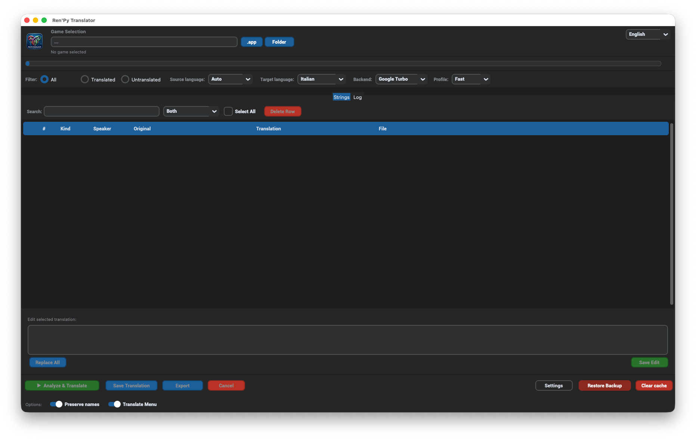
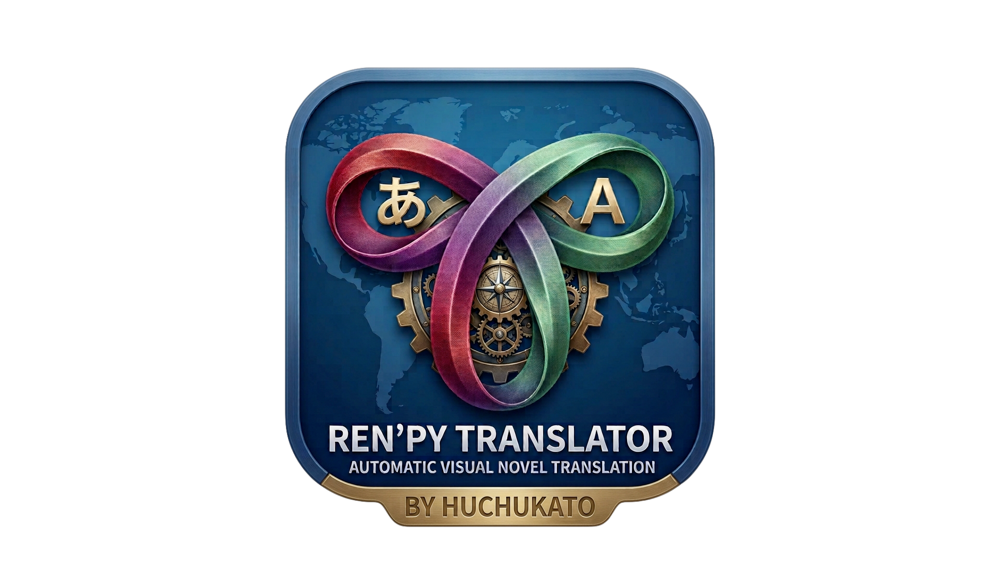

# 🌐 [Tool] Ren'Py Translator v2.2.0 — Auto-translate Ren'Py games

Hey everyone! 👋

**Ren'Py Translator** is a universal GUI tool that automatically extracts, translates and reinstalls translations for Ren'Py games. It handles `.rpa` archives, `.rpyc` decompilation, dialogue/narration parsing, and writes standard `game/tl/<lang>/` files. No manual script editing required. 😎

---

## 📋 Quick Info

- **Name:** Ren'Py Translator
- **Version:** 2.2.0
- **Platform:** Windows / macOS / Linux 🖥️
- **License:** As-is, use at your own risk ⚠️
- **Requirements:** Python 3.9+ and `customtkinter`, `pillow`, `deep-translator`, `requests`, `httpx`

---

## ✨ What It Can Do

- 📦 Auto-extracts `.rpa` archives and decompiles `.rpyc` files.
- 🧠 Detects dialogue, narration, menu choices, `renpy.input()` prompts and native `_("...")` UI strings.
- 🌍 Multiple translation backends:
  - **Google Turbo** — free, fast, 12 mirrors with health tracking.
  - **Bing Turbo** — free, parallel sessions.
  - **OpenRouter** — API key powered.
  - **Llama Local** — local `.gguf` model.
- 🌐 Source language selector — choose `Auto` or a manual source language.
- 🌐 UI in **English, Italian and Spanish**.
- 🛡️ Token protection — preserves Ren'Py tags `{color=...}`, `[variable]`, etc.
- 📄 Paginated editable table — review and edit machine translations before saving.
- 💾 Persistent per-language-pair cache in `~/.cache/renpy-translator/`.
- 💾 **Save Translation** writes `game/tl/<lang>/` and installs the activator.
- 📦 **Export** creates a standalone `GameName-<lang>/` folder even without patching the game.
- 🔧 **CTkMaker export** — export the GUI layout for visual customization.

---

## 📸 Screenshots

<!-- Replace with actual screenshots before posting -->
- 
- 

---

## ⬇️ Download

<!-- Replace with the actual download link / attachment before posting -->
- 🎁 **Latest release:** [RenPy-Translator-v2.2.0.zip](LINK_HERE)
- 💻 **Source:** [GitHub repository](https://github.com/huchukato/RenPy-Translator)

---

## 🚀 Installation & Quick Start

### macOS / Linux

```bash
./start.sh
```

### Windows

```bat
start.bat
```

### Manual

```bash
pip install customtkinter pillow deep-translator requests
python3 translator_tool.py
```

---

## 🔄 How to Use

1. 🎮 **Select the game** — `.app` on macOS or game folder on Windows/Linux.
2. 🌐 Choose a **source language** (`Auto` or manual) and a **target language**.
3. ⚙️ Pick a **translation backend** and a **profile** (`Safe`, `Balanced` or `Fast`).
4. 🚀 Click **Analyze & Translate**.
5. 📝 Review and edit translations in the paginated table.
6. 💾 Click **Save Translation** to install the translation.
7. 📦 Optionally click **Export** to build a distributable `GameName-<lang>/` folder.

---

## 🆕 Changelog

### v2.2.0

- 🔧 **Walkthrough mod compatibility** — auto-generates a compatibility patch for third-party WT mods (e.g. Ronnu's) so that choice hints display correctly in translated games.
- 🏗️ **macOS DMG installer** — `build_mac_app.sh` now creates a `.dmg` with Applications symlink for drag-and-drop install.
- 🏗️ **Linux & Windows build scripts** — `build_linux.sh` (tar.gz + embedded venv) and `build_win.sh` (zip + auto-setup venv).
- ⚡ **Bing Turbo** — new session pool with cooldown and retry logic, httpx support, removed broken `cn.bing.com` endpoint.
- 🐛 Fixed: WT mod hints disappeared after translation due to caption language mismatch.
- 🐛 Fixed: Parser no longer extracts dead `MENUS` dict values from `init python` blocks.

### v2.1.0

- 🎉 New multi-step workflow: **Analyze & Translate** → **Review/Edit** → **Save** → **Export**.
- 🌐 **Source language selector** — `Auto` detection or manual source language.
- 🌐 **Spanish UI** added to English and Italian.
- 🖌️ **Refreshed color palette** matching the new logo tones.
- 🖥️ **Fit-to-screen window** opens at 90% screen size.
- 🔧 **CTkMaker export** for visual customization of the GUI layout.
- ⚙️ **Translation profiles** (`Safe`, `Balanced`, `Fast`) for Google/Bing Turbo.
- 🧠 **Smart parsing** improvements for `renpy.input()` and `_("...")` UI strings.
- 💾 **Persistent translation cache** per language pair.
- 📦 Export folders now use the actual game name.
- 🖼️ Splash image path fixed to `img/splash.png`.
- 🔧 `build/build.sh` now reads the version from `pyproject.toml` automatically.

---

## 📝 Notes

- Translations are written to `game/tl/<lang>/` inside the selected game.
- The cache lives in `~/.cache/renpy-translator/` and skips already translated strings.
- For best results use `Balanced` profile; use `Fast` only for short jobs.
- If you also use **Ren'Py WTForge**, translate first, then generate the mod.
- Third-party walkthrough mods (e.g. Ronnu's) are automatically patched for translated caption compatibility.

---

## 🙏 Credits

- **Ren'Py Translator** by huchukato 💪
- UnRen Tools by **huchukato, goobdoob, jimmy5 & Sam**
- rpatool by **[Shiz](https://codeberg.org/shiz/rpatool)**
- unrpyc by **[CensoredUsername](https://github.com/CensoredUsername/unrpyc)**

---

Hope you find it useful! Happy translating! 🎉
